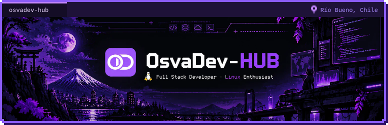
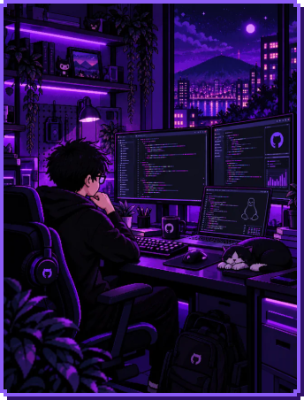
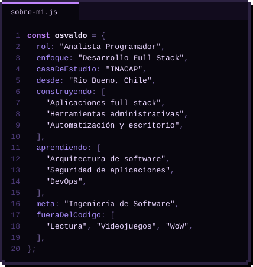
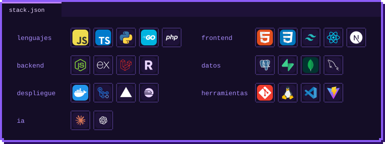
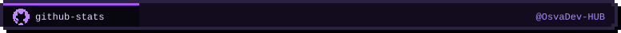

  <!-- Presentacion y contacto -->
  
   
  
  
  
   
  
    
  <!-- Sobre mi -->
  
  
   
  
    
  <!-- Stack -->
  
    
  <!-- Estadisticas de GitHub -->
  
   
  
   
  
  
   
  
    
  Hecho con curiosidad desde Río Bueno, Chile 🇨🇱

